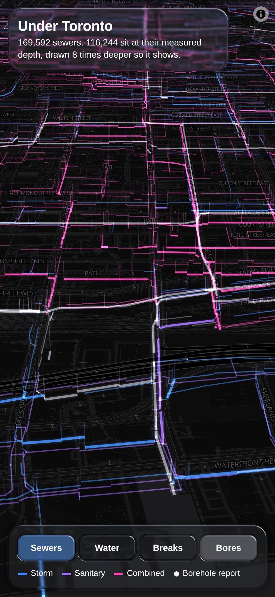

# Under Toronto

By [Blair Zasitko](https://blairz.ca)

**Open it: https://blairz.ca/under/** (made for a phone)

What is under the streets, drawn where it is and as deep as it is.

| Layer | What is real |
|---|---|
| **Sewers** (169,592) | Depth. The city publishes the top elevation of each maintenance hole and the invert elevation of each pipe; one minus the other is how deep the pipe is. Measured for 116,244 pipes; the rest get the median for their kind. Drawn 8 times deeper so it shows |
| **Watermains** (49,418) | The year each was laid. The oldest in service is from 1870 |
| **Breaks** (35,465) | Every watermain break from 1990 to 2016 |
| **Bores** (916) | Foundation reports from the Ontario Ministry of Transportation, each linked to the ministry's page for it |

## How it works

- `build/build.py` reads about 240 MB of city files and writes about 7 MB: every line segment
  as an 8-byte vertex (position in a bounding box, a depth or a year, a kind, flags). It also
  writes `meta.json`, which holds every number the app states, so the text cannot drift from the data.
- `app/mapkit/packed.js` is one WebGL layer on a [MapLibre](https://maplibre.org/) map that draws
  those vertices in 3D below the ground plane. The box-to-screen matrix is composed in 64-bit
  JavaScript, because doing it in the shader's 32-bit floats wobbles by a metre at street zoom.
- Nothing animates. The layer draws only when the map does, so a still map is idle.
- `app/mapkit/boot.js` holds what every map app of mine repeats: map defaults (2x, multisampled),
  loading fully before showing, one small opening move of the camera.
- Controls are from [glass-ui-kit](https://github.com/datumsOG/glass-ui-kit). A switch that is
  on is stained the colour of the layer it shows.

To rebuild the data, download the files named at the top of `build/build.py` into `data/raw/`.

## How it was made

I chose the subject and the data, directed the design, and directed its construction with AI
coding agents (Claude Code).

## Data and credits

- Sewers, maintenance holes, watermains, breaks: City of Toronto Open Data, under the
  [Open Government Licence – Toronto](https://open.toronto.ca/open-data-license/).
- Foundation reports: Ontario Ministry of Transportation.
- Map: [OpenFreeMap](https://openfreemap.org/), © [OpenStreetMap](https://www.openstreetmap.org/copyright) contributors.

The code is MIT-licensed (see `LICENSE`). The data stays under its own licence.
